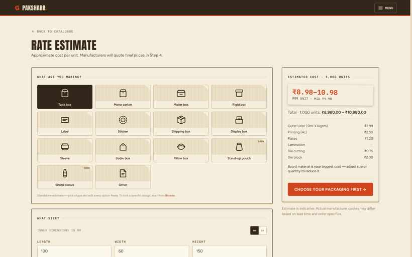
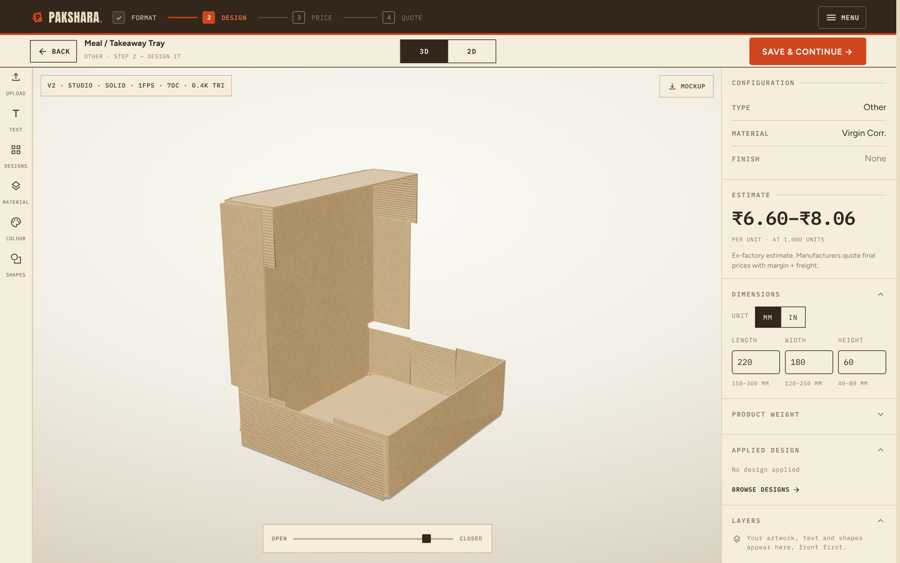

# Pakshara case study: B2B packaging marketplace built with AI coding agents

Pakshara ([pakshara.in](https://www.pakshara.in)) was a marketplace for custom packaging, for small and mid-sized Indian brands (MSMEs) and the printing presses that make their boxes. I ran it between Jan and Sep 2026, then wound it down. The site is still live. The source code is private, so this repo explains the product and how it was built.

## The problem
Between Jan and Apr 2026 I interviewed MSME brands and printing presses. Most packaging quotes ran on WhatsApp with no price benchmark, so a buyer could not tell a fair quote from a padded one. I launched v1 in July 2026.

## What I built
- A four-role marketplace (buyer, manufacturer, designer, admin) with 68 pages, admin-approved quotes and automatic matching of quote requests to presses that can do the job.
- A packaging rate calculator built from the costing methods of NCR presses and cross-checked against their quotes. 54 visitors ran 655 estimates, mostly at real order sizes (median 1,000 pieces).
- A dieline engine that generates 96 standard box structures (60 ECMA, 36 FEFCO) with 3D fold previews and press-ready DXF/SVG export.

## How I built it
I do not write production code. I wrote the specs, ran Claude Code and Codex as parallel build lanes, and reviewed and merged 245 agent commits myself. The stack was Supabase, Vercel and Resend, with a 10-event PostHog funnel to see where buyers dropped off.

## Supply and demand
- Supply: built a lead list of 377 NCR packaging manufacturers from Google Maps and IndiaMART, cold-pitched 27 presses and 16 designers, and signed up 6+ presses and 3+ designers.
- Demand: 300+ visitors and 3,100+ page views in 3 months with no ad spend. About a third came from Google search after I shipped 9 blog posts and 7 category pages.
- Orders: quote requests came from 4 buyers. I matched one NCR buyer with a partner press for a matchmaking fee and declined 3 requests outside NCR coverage.

## What I decided after launch
I weighed 7 business-model options against an evidence log. I dropped designer services when interviews showed designers would not accept delayed commission payouts. The harder problem was supply: Pakshara needed presses with good quality at low order quantities, and there were too few. Each way forward needed capital, a team and industry experience I didn't have, so I wound it down in September 2026.

## Screenshots
**Rate calculator**

**Dieline engine, 3D fold preview**

The full product is live at [pakshara.in](https://www.pakshara.in).

More: [portfolio](https://devgautam-portfolio.notion.site/Dev-Gautam-c275edeb581e4c99bf7d45cbe57649c6) · devgautam.iitkgp@gmail.com
